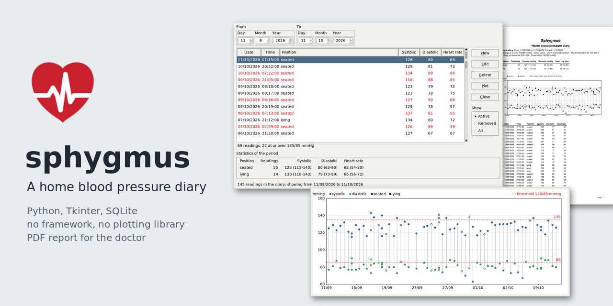
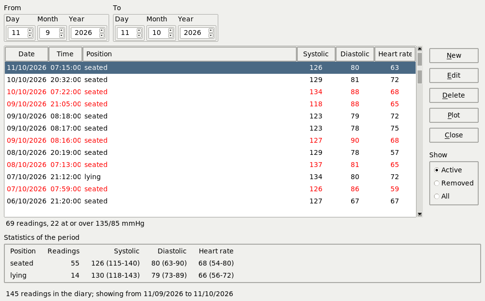
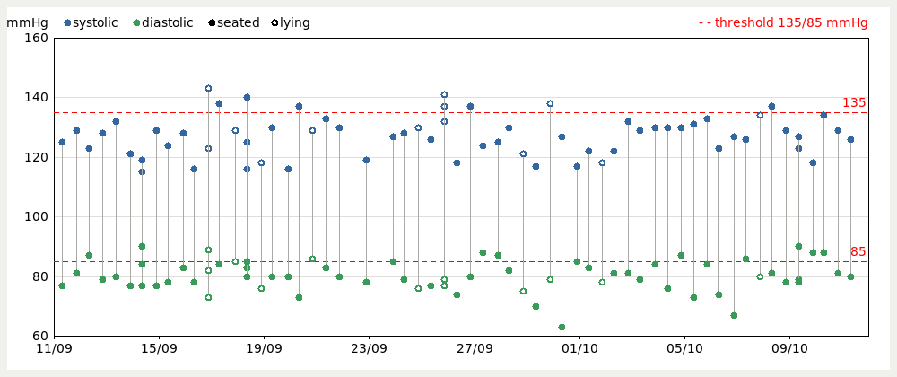
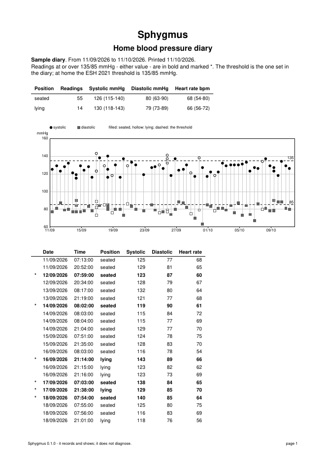

# sphygmus



From the Greek *sphygmós*, the pulse: the root of *sphygmomanometer*.

A home blood pressure diary: Python, Tkinter and SQLite, with a PDF report
to take to the doctor.



## What it does

- Records each reading as the device shows it: date and time, systolic,
  diastolic, heart rate, and whether it was taken seated or lying down.
  A reading is typed in its own form; the date and time follow the clock
  until they are touched.
- Lists the readings of a period and marks in red those at or over the
  home threshold of 135/85 mmHg (ESH 2021). The threshold is a setting.
- Never deletes: a correction disables the reading and stores the new one,
  a removed reading is shown in grey on request and can be brought back.
- Shows the statistics of the period by position: number of readings,
  mean, minimum and maximum.
- Plots the readings over time, drawn by hand on a Tkinter canvas.
- Writes a PDF report with ReportLab - the statistics, the plot and every
  reading - and opens it as a print preview.
- Backs up, restores, checks and vacuums the diary; says how to measure,
  after the ESH 2021 position paper.



The report to take to the doctor, first page; it prints in black and white
without losing anything:



It records and shows. It does not diagnose or advise.

## Why it is written the way it is

The project is small on purpose, and meant to be read. `CONVENTIONS.md`
gives the rules and the reason for each: one field for date and time, no
means stored, the threshold as data, one person and so no patient table.

The general rules come from
[fundamenta](https://github.com/1966bc/fundamenta).

## Running it

```bash
python3 sphygmus.py                        # the diary named in sphygmus.ini
python3 sphygmus.py --trace                # and print what it does
python3 -m unittest discover -s tests      # better: under xvfb-run -a
```

The first start creates the diary, empty. To look around first, File >
Demo diary opens a diary of invented readings, built afresh in a temporary
folder and removed when it is closed: the title says DEMO while it is open.
The same readings can be written to a file that stays:

```bash
python3 seed.py sample.sl3
python3 sphygmus.py --database sample.sl3
```

## The database

One SQLite file. A new diary is built from `sql/ddl/001_schema.sql` and
`sql/dml/001_master_data.sql`, then by the numbered migrations in
`sql/ddl`, which also bring an older diary up to date after copying it into
`backup/`. File > Database backs it up, restores a backup, checks it and
vacuums it.

The repository carries the schema and the generator of invented readings,
never a real diary.

## Requirements

Python 3.7 or later with Tkinter (`python3-tk` on Debian), and ReportLab for
the report.

## Licence

GPL-3.0-or-later, see `LICENSE`.

Giuseppe Costanzi ([1966bc](https://github.com/1966bc))
